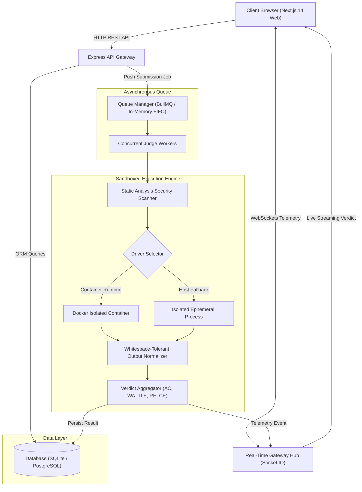

<div align="center">

# ⚔️ CodeArena

**An enterprise-grade, distributed Online Judge and Competitive Programming platform.**  
Built for real-time competitive programming contests, high-throughput code execution, and collaborative algorithmic problem-solving.

[](https://github.com/Ayushkr-iitm/CodeArena/actions/workflows/ci.yml)
[](https://github.com/Ayushkr-iitm/CodeArena)
[](docker-compose.yml)
[](https://nodejs.org/)
[](https://www.typescriptlang.org/)
[](LICENSE)

[Live Demo](http://localhost:3000) • [Architecture](#-architecture--data-flow) • [Features](#-platform-features) • [Quickstart](#-quickstart) • [API Docs](#-api-reference)

</div>

---

## 📖 Overview

**CodeArena** is a production-ready competitive programming platform modeled after platforms like Codeforces and LeetCode. It features a distributed code execution engine that evaluates untrusted user submissions in real time across **C++ (g++)**, **Python 3**, and **Java** inside hardened sandboxes.

The platform includes full real-time telemetry over WebSockets, timed contest scoring using the official ICPC penalty system, interactive Monaco code editing, threaded community discussion boards, progressive hint reveals, and comprehensive test coverage.

---

## 🏛️ Architecture & Data Flow



---

## ✨ Platform Features

### ⚡ Distributed Sandboxed Execution Engine
* **Multi-Language Support**: Compiles and executes **C++ (g++ 6+)**, **Python 3.12**, and **Java** with strict time (ms) and memory (MB) limits.
* **Dual Execution Drivers**: Production Docker containerization with automatic fallback to isolated, ephemeral local process sandboxes.
* **Whitespace-Tolerant Checker**: Handles differing line endings (CRLF vs. LF), trailing whitespace, and blank lines while generating accurate line-by-line diff summaries.

### 🛡️ Defense-in-Depth Security
* **Static Analysis AST Scanner**: Proactively scans code prior to execution to intercept prohibited system calls (`fork`, `system`, `execve`), network sockets (`socket`, `<sys/socket.h>`, `<windows.h>`), and process escalation.
* **Multi-Tier Rate Limiting**: Dedicated rate limiters on authentication, code submissions, and community endpoints to mitigate brute-force and DoS attacks.
* **Security Headers**: Hardened with Helmet, CORS policy enforcement, and parameter validation via Zod schemas.

### 🔄 Asynchronous Worker Queue
* **BullMQ & Redis Architecture**: Asynchronous background job processing with zero thread blocking on the primary HTTP server.
* **Resilient In-Memory Fallback**: Seamless zero-config in-memory FIFO worker pool if Redis is unavailable during local development.

### 📡 Real-Time WebSockets & Telemetry
* **Socket.IO Event Hub**: Live streaming status updates (`PENDING` ➔ `RUNNING` ➔ `ACCEPTED` / `WRONG_ANSWER`).
* **Live Contest Standings**: Real-time ICPC scoreboard recalculations broadcast to all connected contestants.
* **Presence & Activity Feed**: Real-time online user counters and platform-wide live submission tickers.

### 🏆 Timed Contests & ICPC Scoring
* **Contest Lifecycle Management**: Supports Upcoming, Active, and Finished states with synchronized countdown timers.
* **Official ICPC Penalty System**: Computes standings by problems solved with tie-breaking penalty minutes:
  $$\text{Penalty} = \text{Elapsed Minutes to Solve} + (20 \times \text{Rejected Attempts})$$

### 💻 Monaco Code Editor Workbench
* **VS Code Editor Core**: Syntax highlighting, bracket matching, indentation guides, and keyboard shortcuts.
* **Multi-Tab Workbench**: Five dedicated panes: **Description**, **Editorial**, **Community Solutions**, **Discussion**, and **Submissions**.
* **Live Testcase Playground**: Custom stdin input/output testing before formal contest submission.

### 🌐 Community & Collaborative Learning
* **Progressive Hint Reveals**: Multi-stage hints (💡 Hint 1, 2, 3) allowing users to learn without spoiling full solutions.
* **Community Solutions**: User-submitted approaches with Big-O time and space complexity badges and upvote voting.
* **Threaded Discussions**: Nested comment hierarchies with real-time score updates.

---

## 🗂️ Monorepo Structure

```
codearena/
├── .github/workflows/ci.yml       # GitHub Actions CI/CD Pipeline (Build + 51 Tests)
├── apps/
│   ├── api/                       # Express + TypeScript Backend & Execution Engine
│   │   ├── prisma/                # Database schema, migrations, and seed scripts
│   │   ├── src/
│   │   │   ├── app.ts             # Express application & middleware configuration
│   │   │   ├── judge/             # Sandbox drivers, compilers, runner & security scanner
│   │   │   ├── middleware/        # JWT auth, rate limiters, error handling
│   │   │   ├── queue/             # BullMQ Redis queue & in-memory worker pool
│   │   │   ├── routes/            # Auth, Problems, Submissions, Contests, Community
│   │   │   └── socket/            # Socket.IO real-time event hub
│   │   └── tests/                 # Unit, Integration, and E2E test suites
│   └── web/                       # Next.js 14 App Router Frontend
│       ├── public/                # Static assets & icons
│       └── src/
│           ├── app/               # Next.js App Router (Problems, Contests, Profile, Admin)
│           ├── components/        # Monaco workbench, discussion threads, leaderboards
│           └── lib/               # Socket.IO client, API fetch client
├── packages/
│   └── shared/                    # Monorepo shared TypeScript types and constants
├── Dockerfile.api                 # Multi-stage Dockerfile for API & Judge Sandbox
├── Dockerfile.web                 # Multi-stage Dockerfile for Next.js Frontend
├── docker-compose.yml             # Full-stack composition (PostgreSQL, Redis, API, Web)
└── package.json                   # Monorepo workspace configuration
```

---

## 🚀 Quickstart

### Option 1: Docker Compose (Production Setup)

Spin up the entire stack—PostgreSQL, Redis, the Execution Engine, and the Next.js Frontend—with a single command:

```bash
docker-compose up -d --build
```

Access the services:
* **Frontend Web App**: [http://localhost:3000](http://localhost:3000)
* **Backend API Gateway**: [http://localhost:4000](http://localhost:4000)
* **API Health Check**: [http://localhost:4000/api/health](http://localhost:4000/api/health)

---

### Option 2: Local Development Setup

#### 1. Prerequisites
* **Node.js**: `v18.0.0` or higher (tested on Node 20 & 24)
* **C++ Compiler**: `g++` (MinGW on Windows, GCC on Linux/macOS)
* **Python**: `python3` (v3.10+)

#### 2. Installation
Clone the repository and install all dependencies across monorepo workspaces:

```bash
git clone https://github.com/Ayushkr-iitm/CodeArena.git
cd CodeArena
npm install
```

#### 3. Database Initialization & Seeding
```bash
# Push schema to SQLite database
npm run db:push

# Seed starter problems, tags, users, and contests
npm run db:seed --workspace=apps/api

# Seed community discussions, solutions, and hints
npm run --workspace=apps/api tsx prisma/seed-community.ts
```

#### 4. Run Development Servers
```bash
# Start backend API (Port 4000)
npm run dev:api

# Start frontend application (Port 3000)
npm run dev:web
```

---

## 🔑 Default Credentials

Pre-seeded credentials for local evaluation:

| Role | Email | Password | Access Level |
| :--- | :--- | :--- | :--- |
| **Administrator** | `admin@codearena.com` | `admin123` | Problem creation, contest scheduling, full management |
| **Competitor** | `user@codearena.com` | `user123` | Problem solving, contest participation, community sharing |

---

## 🧪 Testing & Quality Assurance

CodeArena includes comprehensive automated test suites covering unit logic, database integration, and end-to-end sandbox execution:

```bash
# Run all test suites across the entire monorepo
npm test

# Run specific test suites
npm run test:unit --workspace=apps/api         # Unit tests (checker, compiler, queue, scoring, security)
npm run test:integration --workspace=apps/api  # Integration tests (auth, sessions, community)
npm run test:e2e --workspace=apps/api          # E2E judge pipeline tests (Python & C++ execution)
```

```
Test Results:
  ✔ Checker Normalization (whitespace, CRLF/LF, diffs)
  ✔ Judge Compiler Diagnostics (C++, Python)
  ✔ Asynchronous Worker Pool & In-Memory Queue
  ✔ ICPC Penalty Scoring Formula & Rating Bonuses
  ✔ Sandbox Security AST Scanner (Syscall & Network Interception)
  ✔ Authentication & JWT Lifecycle (Register, Login, Protected Me)
  ✔ Community Discussions, Threaded Replies & Solution Voting
  ✔ E2E Code Execution across all verdicts (AC, WA, TLE, RE, CE)

ℹ tests 51 | ℹ suites 15 | ℹ pass 51 | ℹ fail 0 (100% Passing)
```

---

## 🔌 API Reference

### Authentication (`/api/auth`)
* `POST /api/auth/register` — Register a new competitor account.
* `POST /api/auth/login` — Authenticate and receive access/refresh JWT tokens.
* `POST /api/auth/refresh` — Issue a new access token using a valid refresh token.
* `GET /api/auth/me` — Retrieve the profile of the currently authenticated user.

### Problems (`/api/problems`)
* `GET /api/problems` — Paginated list of problems with difficulty, tag, and search filters.
* `GET /api/problems/:slug` — Retrieve full problem statement, metadata, and sample testcases.
* `POST /api/problems` *(Admin)* — Create a new problem with testcases.

### Submissions & Judge (`/api/submissions`)
* `POST /api/submissions` — Submit code for evaluation; returns HTTP 202 with job tracking ID.
* `GET /api/submissions/:id` — Retrieve submission status, runtime, memory, and verdict telemetry.
* `GET /api/submissions/problem/:problemId` — Retrieve personal submission history for a problem.

### Contests (`/api/contests`)
* `GET /api/contests` — List upcoming, ongoing, and past contests.
* `GET /api/contests/:slug` — Contest details, rules, and problem catalog.
* `POST /api/contests/:id/register` — Register current user for a contest.
* `GET /api/contests/:slug/leaderboard` — Real-time contest standings computed with ICPC scoring.

### Community (`/api/community`)
* `GET /api/community/comments/:problemId` — Threaded discussion comments and replies.
* `POST /api/community/comments` — Post a new comment or reply to an existing comment.
* `POST /api/community/comments/:id/vote` — Upvote or downvote a comment.
* `GET /api/community/solutions/:problemId` — Community-shared solutions with complexity tags.
* `POST /api/community/solutions` — Publish a solution and approach explanation.
* `POST /api/community/solutions/:id/vote` — Toggle upvote on a community solution.
* `GET /api/community/editorial/:problemId` — Official editorial and progressive hints.

### Users & Leaderboard (`/api/users`)
* `GET /api/users/leaderboard` — Global leaderboard ranked by rating.
* `GET /api/users/profile/:username` — Public user profile, solved distribution, and submission history.

---

## ⚙️ Environment Variables

### Backend (`apps/api/.env`)
| Variable | Description | Default |
| :--- | :--- | :--- |
| `PORT` | API & WebSocket server port | `4000` |
| `DATABASE_URL` | Prisma connection string (SQLite / PostgreSQL) | `file:./dev.db` |
| `REDIS_URL` | Redis server connection URI for BullMQ | `redis://localhost:6379` |
| `JWT_ACCESS_SECRET` | Secret key for signing short-lived access tokens | *required* |
| `JWT_REFRESH_SECRET` | Secret key for signing refresh tokens | *required* |
| `FRONTEND_URL` | Allowed CORS origin | `http://localhost:3000` |
| `JUDGE_CONCURRENCY` | Maximum concurrent sandbox execution slots | `4` |

### Frontend (`apps/web/.env.local`)
| Variable | Description | Default |
| :--- | :--- | :--- |
| `NEXT_PUBLIC_API_URL` | Backend REST API endpoint | `http://localhost:4000/api` |
| `NEXT_PUBLIC_SOCKET_URL` | Socket.IO WebSocket gateway | `http://localhost:4000` |

---

## 📄 License

This project is licensed under the **MIT License** — see the [LICENSE](LICENSE) file for details.
